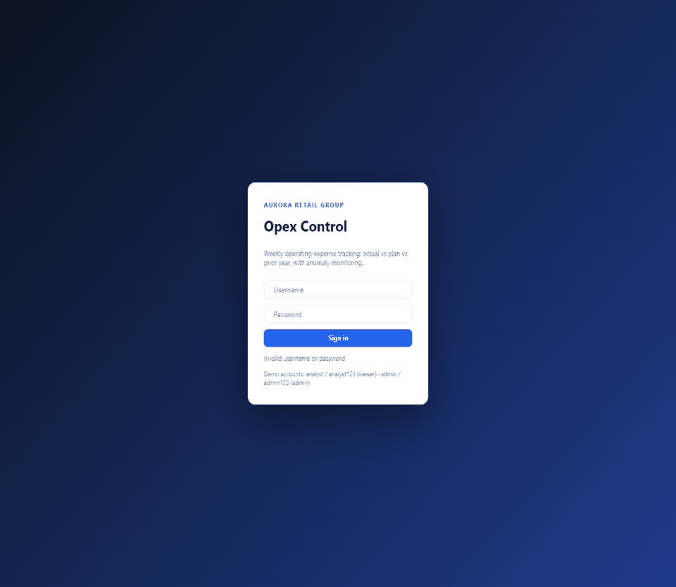
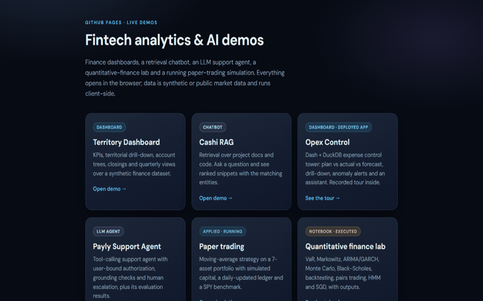
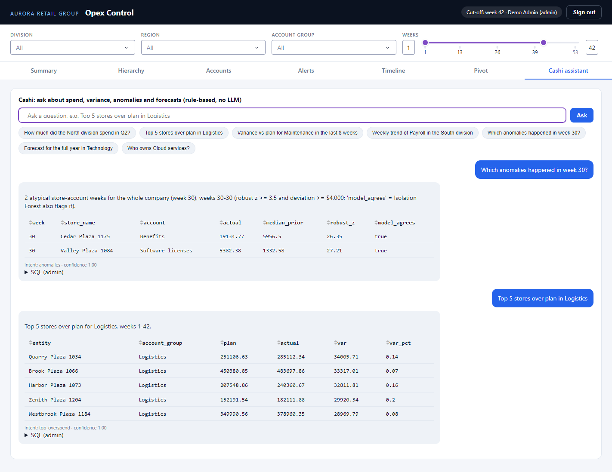
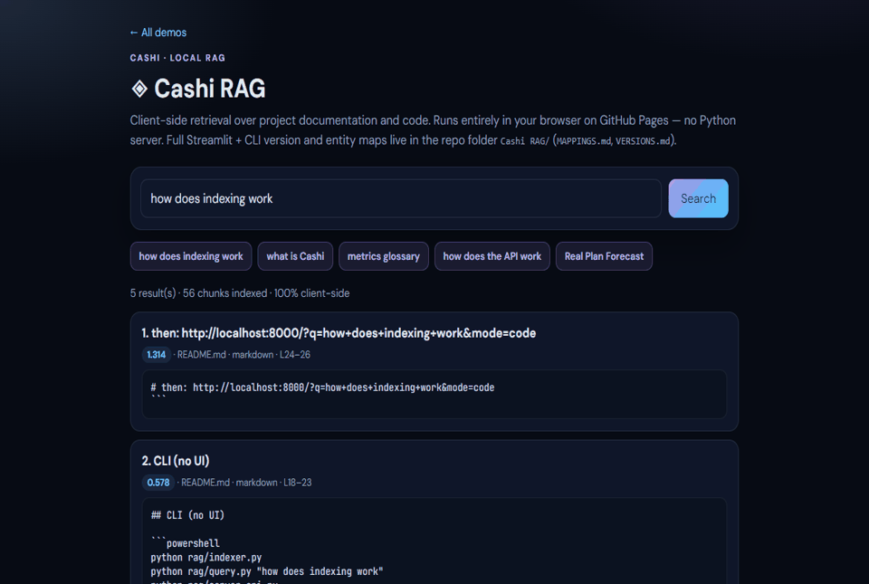
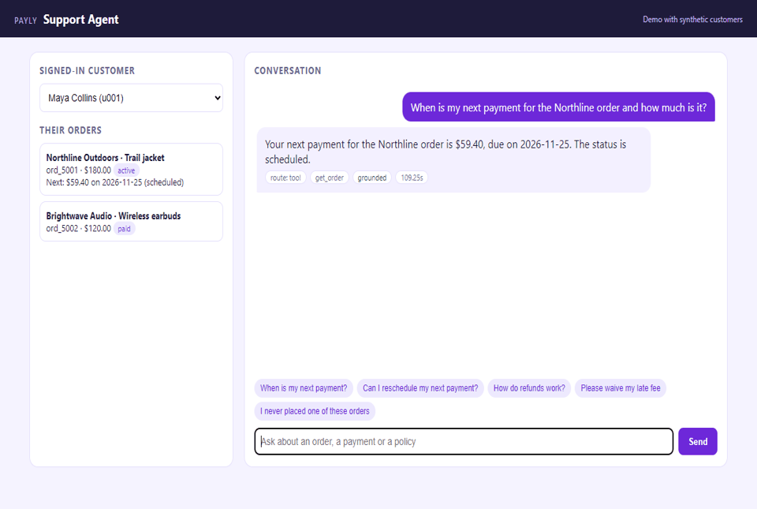
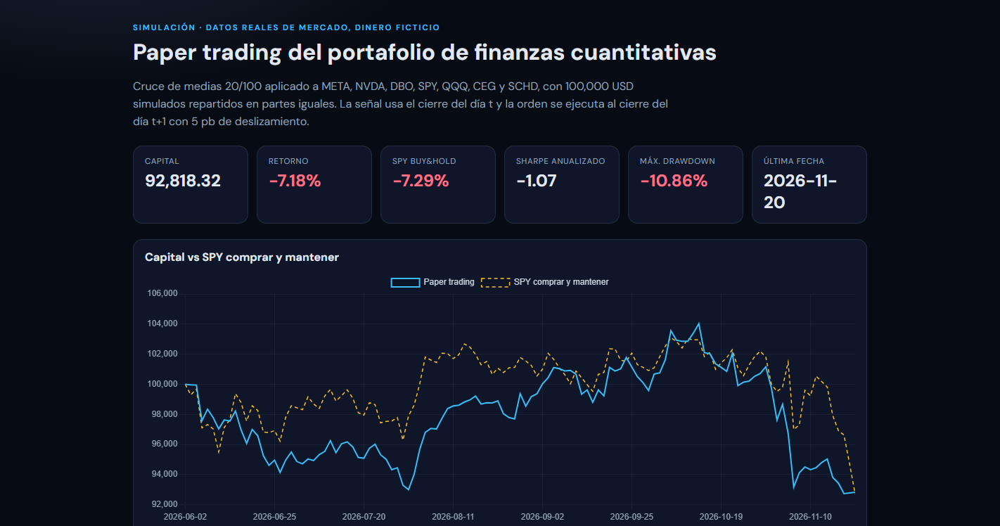
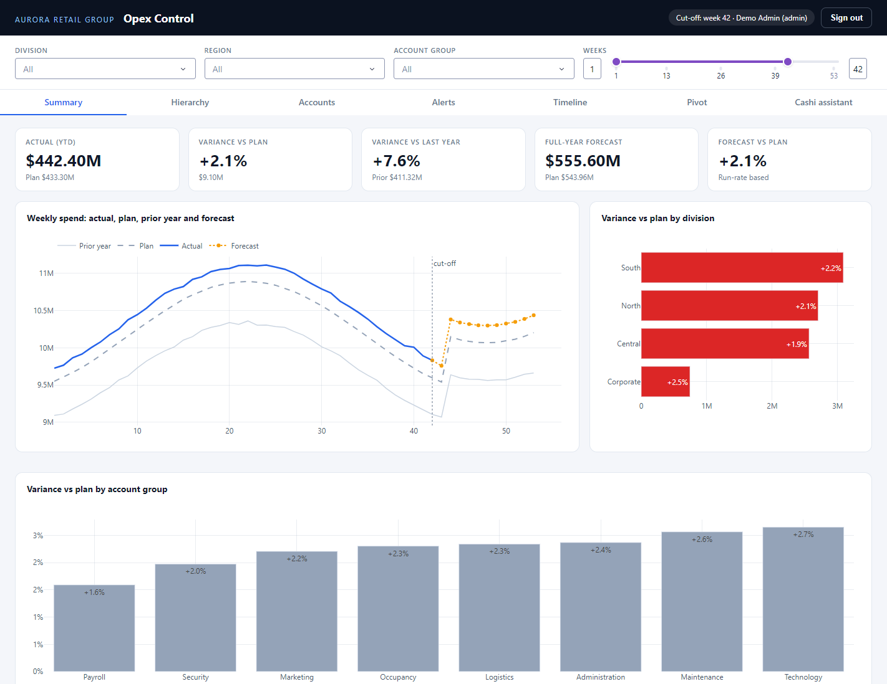
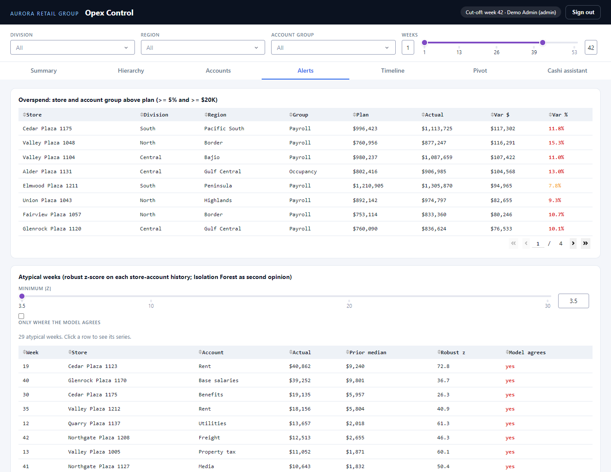
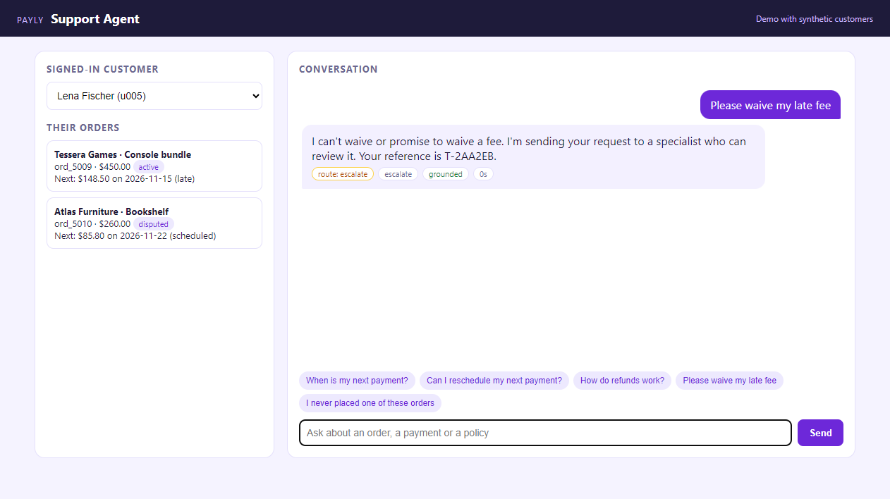
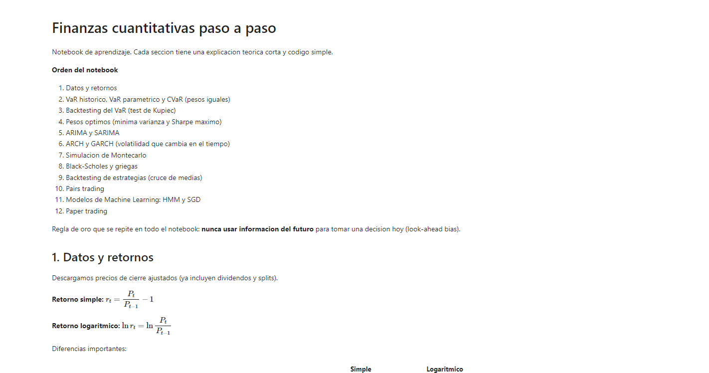

# My_Portfolio

Applied finance and AI projects, each with a live browser demo, its source code, tests where it makes sense, and recorded screenshots. All data is synthetic or public market data; nothing here comes from a real employer or customer.



Shareable GIFs of every project (under 1 MB each) are in [`share/`](share/README.md).

## Tour of the published site



## Projects

| | Project | What it is | Demo | Code |
|---|---------|-----------|------|------|
| 1 | **Opex Control** | Dash + DuckDB expense control tower: plan vs actual vs forecast, drill-down, anomaly alerts, roles, rule-based assistant. 39 tests. | [`docs/opex-control`](docs/opex-control/index.html) | [`opex-control/`](opex-control) |
| 2 | **Payly Support Agent** | Tool-calling LLM agent for buy-now-pay-later support: user-bound authorization, grounding check, no-LLM escalation, golden-set evaluation. 39 tests. | [`docs/support-agent`](docs/support-agent/index.html) | [`support-agent/`](support-agent) |
| 3 | **Paper trading** | 20/100 moving-average strategy on a 7-asset portfolio with 100,000 USD of simulated capital and a daily-updated ledger. | [`docs/paper-trading`](docs/paper-trading/index.html) | [`quant-lab/paper_trading`](quant-lab/paper_trading) |
| 4 | **Quantitative finance lab** | Executed notebook: VaR/CVaR, Kupiec, Markowitz, ARIMA/GARCH, Monte Carlo, Black-Scholes, backtesting, pairs trading, HMM, SGD. | [`docs/quant-lab`](docs/quant-lab/index.html) | [`quant-lab/`](quant-lab) |
| 5 | **Territory Dashboard** | Territorial spend dashboard with drill-down, account trees and quarterly views. Streamlit app plus a static demo. | [`docs/dashboard`](docs/dashboard/index.html) | [`dashboard/`](dashboard) |
| 7 | **Notebooks** | 30 notebooks with saved outputs: risk, trading, quantum algorithms, causal inference, LLM engineering, sports analytics. | [`notebooks/README.md`](notebooks/README.md) | [`notebooks/`](notebooks) |
| 7 | **Notebooks** | 30 notebooks with saved outputs: risk, trading, quantum algorithms, causal inference, LLM engineering, sports analytics. | [`notebooks/README.md`](notebooks/README.md) | [`notebooks/`](notebooks) |
| 8 | **Weekly Spend Control Dashboard (source)** | Source of a production-style Dash + DuckDB dashboard with pipeline, exports, roles and a rule-based assistant. Runs on synthetic data with a recorded tour. Identifiers and real data removed; see its README. | [`docs/dash-app`](docs/dash-app/index.html) | [`dash-app/`](dash-app) |
| 6 | **Cashi RAG** | Retrieval over docs and code chunks with entity detection. Streamlit app plus a static demo. | [`docs/chatbot`](docs/chatbot/index.html) | [`chatbot/`](chatbot) |

Once Pages is enabled the demos are served at `https://<user>.github.io/<repo>/`.

## Demos: how each one works

**Dashboard (Opex Control).** Sign in, filter by division, region, account group and weeks, drill from division down to store, review alerts and export tables as admin.


**Chatbot (Cashi).** Ask in plain English; the dashboard version answers from the same queries, and the standalone RAG demo returns ranked snippets with entities.

| Assistant inside the dashboard | Standalone Cashi RAG |
|---|---|
|  |  |

**LLM support agent (Payly).** Each answer shows its route, the tools used and whether every amount and date was grounded. Fee waivers and fraud reports are escalated with a ticket instead of answered. Model results: 19/25 on a local llama3.1:8b ([EVAL.md](support-agent/EVAL.md)).



**Paper-trading simulation.** 100,000 USD of simulated capital on META, NVDA, DBO, SPY, QQQ, CEG and SCHD with a 20/100 moving-average rule, compared with SPY. The record starts 2026-11-20; earlier days are marked `backfill`.



## More screenshots

| Opex Control: summary | Opex Control: alerts |
|---|---|
|  |  |
| **Opex Control: assistant** | **Payly Support Agent** |
|  |  |
| **Paper trading** | **Quantitative finance lab** |
|  |  |

The Payly captures come from the real local model (`llama3.1:8b`, CPU), so they show 1-2 minute latencies; results are in [`support-agent/EVAL.md`](support-agent/EVAL.md).

## Highlights

- **Reconciliation first.** Opex Control tests compare the warehouse with the raw data to the cent and check that divisions add up to the company total.
- **Safe by construction.** Parameterised SQL (tested against injection), tools bound to the signed-in customer, escalation without generation, and an answer check that rejects amounts or dates not present in the evidence.
- **Honest evaluation.** The agent's golden set scored 19/25 with a real local model; failures are listed with causes, and a cancelled second run is labelled as partial.
- **Out-of-sample record.** Paper trading tags replayed days as `backfill` and new days as `live`, so only the live rows count as a track record.

## Run locally

```bash
# Opex Control
cd opex-control && pip install -r requirements.txt
python pipeline/generate_data.py && python pipeline/build.py
python app/app.py                      # http://127.0.0.1:8050  (analyst/analyst123, admin/admin123)
python -m pytest -q

# Payly Support Agent
cd support-agent && python data/build_data.py && python -m pytest -q
python web/server.py                   # needs Ollama + llama3.1:8b, or SUPPORT_BACKEND=mock

# Paper trading and notebook
cd quant-lab && pip install -r requirements.txt
python paper_trading/engine.py         # processes new closes only

# Static demos
python -m http.server --directory docs 8000
```

## Deploy

1. Push to GitHub and set **Settings > Pages > Source: GitHub Actions**.
2. `.github/workflows/pages.yml` publishes `docs/`.
3. `.github/workflows/tests.yml` runs both test suites.
4. `.github/workflows/paper-trading.yml` updates the paper-trading ledger every weekday after the US close.

## Layout

```
docs/            static site: landing page and one folder per demo (media/ holds screenshots and GIFs)
opex-control/    pipeline, monitoring, core queries, Dash app, assistant, tests
support-agent/   agent, store, retrieval, guardrails, eval, web UI, DECISIONS.md, EVAL.md
quant-lab/       executed notebook and the paper-trading engine
dashboard/       Territory Dashboard (Streamlit)
chatbot/         Cashi RAG (Streamlit)
```

## Notes

- `opex-control/` and `support-agent/` are written from scratch for this repository. They follow patterns from two larger private projects but reuse none of their code, data, names or documents. Brands, policies, catalogs and numbers are fictional.
- Educational material, not financial advice. Paper-trading results do not predict real performance.
