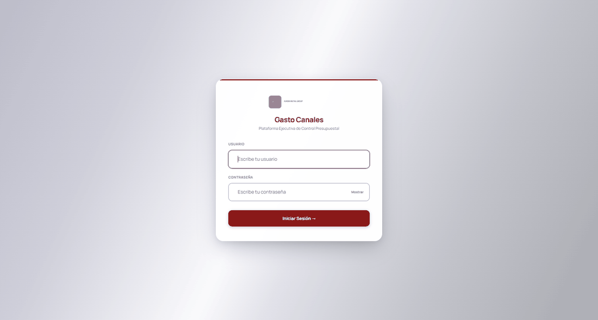

# Weekly Spend Control Dashboard (Dash + DuckDB)

Production-style weekly spend dashboard for a multi-division retail group, with a data pipeline, an analytics warehouse, a multi-tab Plotly Dash app, role-based users, Excel/PDF exports and a rule-based chat assistant (Cashi) that needs no LLM.



Demo recording: [`demo/tour.gif`](demo/tour.gif). Code: [`codigo/`](codigo) (pipeline), [`dash_app/`](dash_app) (app), [`rag/`](rag) (assistant and monitoring), [`synthetic/`](synthetic) (demo data and recorder).

This folder is the source code of the application plus a synthetic-data generator so it runs end to end. Company identifiers, credentials, internal hostnames, people, catalogs, real figures and branded assets were removed or replaced with neutral placeholders (`Aurora`, `<SHARED_DRIVE>`, `sql-server.example.local`). There is **no real data**. `synthetic/make_consolidado.py` writes the same input files the pipeline expects (weekly actual, plan and forecast extracts, the structure and account catalogs in Excel, a forecast workbook and demo users), so the real pipeline and the real app run unchanged. The recorded tour above was captured from the app running on that data. A smaller, fully rewritten version of the same ideas is in [`../opex-control`](../opex-control).

## Run the demo

```bash
pip install -r requirements.txt dash-bootstrap-components waitress scikit-learn
python synthetic/make_consolidado.py          # inputs: datos/*.parquet, Excel catalogs, demo users
python codigo/build_data.py --rebuild --actualizar-catalogos --solo semanal   # builds aggs/ and dashboard.duckdb (~10 s)
python -m rag.monitoreo train --promover && python -m rag.monitoreo score   # anomaly model for the Alerts tab
python dash_app/app.py                        # http://127.0.0.1:8050  (admin1 / admin123, analista1 / analista123)
python synthetic/capture_dash.py              # re-records the tour with headless Chrome
```

The synthetic set has 191 locations, 21 accounts and 53 weeks (about 590,000 fact rows) with actuals up to week 42. The generator also injects 40 cost spikes so the alerts have something to find, and `rag/conocimiento/CONOCIMIENTO_CASHI.md` is a synthetic knowledge file for the assistant. To fill the Alerts tab, train and score the monitor once: `python -m rag.monitoreo train --promover && python -m rag.monitoreo score`. Tabs that need other private inputs (digital channel, expansion closings workbook, labelled evaluation data) start empty or are skipped.

## What is inside

| Path | What it does |
|------|--------------|
| `codigo/build_data.py` | Builds the consolidated fact table, the aggregates and `dashboard.duckdb` from weekly extracts and catalogs |
| `codigo/extraer_sql.py` | Pulls weekly actual, plan and forecast tables from SQL Server (credentials only from `.env`) |
| `codigo/aggs_duckdb.py`, `build_series.py`, `build_digitales*.py` | Aggregates and the digital-channel database |
| `codigo/pruebas_cuadre.py` | Reconciliation checks against the raw extracts |
| `dash_app/` | The app: `pages/` (one per tab), `services/` (DuckDB access, auth, exports, caching), `components/`, `assets/` (CSS, JS, fonts) |
| `rag/` | Cashi assistant: regex intent router, SQL templates, local entity ML, BM25 over a knowledge file, variance and anomaly monitoring (`rag/monitoreo/`) |
| `INICIAR_DASH.bat`, `MENU_DASH.bat` | Windows launchers for the app and the update menu |

## Engineering notes

- The app serves only from DuckDB: one shared connection, a cursor and a lock per query, a bounded memory and thread budget.
- The cut-off week is data (`aggs/_meta.json`), never a constant in code.
- Dual amounts (constant and local currency) are carried side by side; reconciliation tests compare the dashboard to the raw extracts.
- Cashi has no language model: a router, SQL templates and a small local classifier for entities, with a hand-labelled evaluation set.
- Anomaly monitoring combines a robust z-score (median and MAD, IQR fallback, materiality floor) with an Isolation Forest, a champion and challenger registry and a drift check.

## What was left out

Real data and catalogs, the company logo and background image (replaced by generated placeholders), the PowerPoint and Excel templates, change logs and design notes that contain real figures and people, and the hand-labelled evaluation files built from real user questions (the knowledge file is replaced by a synthetic one). Some modules that depend on those templates (`codigo/ppt_semanal`) are included for reference but cannot run without them.

