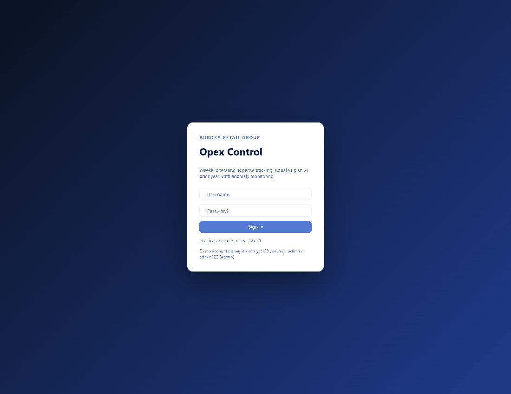

# Opex Control Dashboard

A weekly operating-expense control tower for a fictional retail group (**Aurora Retail Group**, 241 locations, 24 accounts, 53 weeks). It compares actual spend with plan and prior year, projects the year-end close, flags atypical weeks and answers questions in plain English.

All data is synthetic and generated by `pipeline/generate_data.py`. It has the shape of a real finance mart (a weekly fact table at location x account grain with a four-level location hierarchy and an account-group tree), so the architecture is the part that carries over.



Demo recording: [`demo/tour.gif`](demo/tour.gif). Code: [`pipeline/`](pipeline), [`monitoring/`](monitoring), [`core/`](core), [`app/`](app), [`assistant/`](assistant), [`tests/`](tests).

## Architecture

```
pipeline/generate_data.py  ->  data/raw/*.parquet        fact_weekly, dim_store, dim_account, injected_anomalies
pipeline/build.py          ->  data/warehouse/opex.duckdb fact, dims, v_fact view, roll-ups, anomalies, _meta.json
monitoring/anomalies.py    ->  robust z-score + Isolation Forest + PSI drift
core/{db,queries,auth}.py  ->  one read-only DuckDB connection, cursor-per-query, parameterised filters, roles
app/app.py                 ->  Plotly Dash UI (7 tabs, role-gated downloads)
assistant/cashi.py         ->  rule-based question answering over the same query layer (no LLM)
tests/                     ->  39 tests: reconciliation, SQL-injection safety, no-look-ahead, detector recall/precision, assistant gold set
```

Design rules carried over from production dashboards:

- **The app serves only from DuckDB.** One shared connection, a cursor and a lock per query, parameterised filters (a test proves quoting cannot reach SQL).
- **The cut-off week is data, not code.** It is read from `_meta.json`, which the build writes. Actuals stop there; the forecast continues with plan scaled by the last 8-week run rate.
- **Numbers must reconcile before they are shown.** Tests compare the warehouse to the raw parquet to the cent, and divisions must add to the company total.

## Tabs

| Tab | What it answers |
|-----|-----------------|
| Summary | KPIs, weekly actual/plan/prior/forecast, variance by division and account group |
| Hierarchy | Drill from Division to Region to Zone to Store with status flags |
| Accounts | Account groups and accounts with owners |
| Alerts | Stores above plan; atypical weeks with a click-through series chart |
| Timeline | Month x account-group variance heat map, quarterly bars |
| Pivot | Any two dimensions and measure, CSV export (admin) |
| Cashi assistant | "Top 5 stores over plan in Logistics", "Forecast for Technology", "Who owns Cloud services?" |

Roles: `analyst` (viewer) and `admin`. Admins can download tables and see the SQL behind each assistant answer. Demo credentials are printed on the sign-in page; override with `OPEX_ANALYST_PASSWORD` / `OPEX_ADMIN_PASSWORD`.

## Anomaly detection

For each store-account series, week *t* is compared with the median of all earlier weeks only (no look-ahead). The robust z-score uses `0.6745 * (x - median) / MAD`, falling back to half the IQR and then to a 5% floor when MAD is zero. A week is flagged when `|z| >= 3.5` **and** the deviation is at least $4,000, so tiny series cannot trigger alerts. An Isolation Forest trained on early weeks gives a second opinion (`model_agrees`). A PSI check compares the recent actual/plan ratio with earlier weeks to watch drift.

Measured on the synthetic data with 63 injected spikes: 29 weeks flagged, precision 0.97 (28 of 29 are injected spikes) and recall 1.00 on the 18 injected spikes that exceed plan by more than $6,000 (`tests/test_pipeline.py` asserts both at 0.8 or better). Overall recall is 28 of 63, because most injected spikes sit on small accounts below the $4,000 materiality floor; that is by design.

## Cashi assistant

Intent router (regex), entity extraction against the catalogs (divisions, regions, zones, groups, accounts, store names and ids, weeks, quarters, months, "last N weeks", "top N"), SQL templates over the same query layer, fuzzy "did you mean" suggestions, and a confidence flag. 22 gold questions check intent and entities; other tests check that numbers in the sentence equal the query layer.

## Run it

```bash
pip install -r requirements.txt
python pipeline/generate_data.py
python pipeline/build.py          # ~30 s, writes the warehouse and the anomaly table
python app/app.py                 # http://127.0.0.1:8050
python -m pytest -q               # 39 tests
python scripts/capture.py         # re-records screenshots and the GIF with headless Chrome
```

## Limits

Synthetic data only; no live source. Forecasting is a run-rate rule, not a model. The Isolation Forest is a second opinion without labels, so there is no accuracy figure for it, only agreement with the statistical rule. Authentication is a demo (hashed passwords, no sessions server-side).
