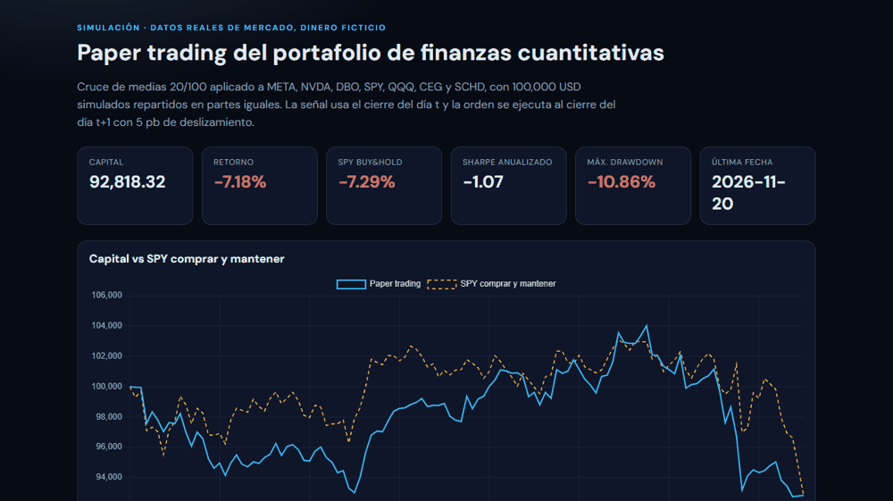

# Quantitative Finance Lab and Paper Trading

An executed notebook of quantitative-finance methods and a local paper-trading simulator that applies one of them to a 7-asset portfolio.



Demo recordings: [`demo/paper-trading.gif`](demo/paper-trading.gif) (simulation page) and [`demo/notebook.gif`](demo/notebook.gif) (notebook as published).

| Path | What it is |
|------|-----------|
| [`finanzas_cuantitativas.ipynb`](finanzas_cuantitativas.ipynb) | Executed notebook: returns, VaR/CVaR and Kupiec, Markowitz, ARIMA/SARIMA, ARCH/GARCH, Monte Carlo, Black-Scholes, backtesting, pairs trading, HMM and SGD, paper trading |
| [`paper_trading/engine.py`](paper_trading/engine.py) | Simulator: 20/100 moving-average cross on META, NVDA, DBO, SPY, QQQ, CEG and SCHD with 100,000 USD, signal at the close of day t and fill at the close of t+1 with 5 bp slippage |
| [`paper_trading/data/`](paper_trading/data) | The ledger: `equity.csv`, `trades.csv`, `state.json` |

```bash
pip install -r requirements.txt
python paper_trading/engine.py --backfill 120   # first run: replay 120 days (tagged backfill)
python paper_trading/engine.py                  # later: process only new closes (tagged live)
```

Only `live` rows are an out-of-sample record. A GitHub workflow updates the ledger every weekday after the US close. Educational material, not financial advice.
