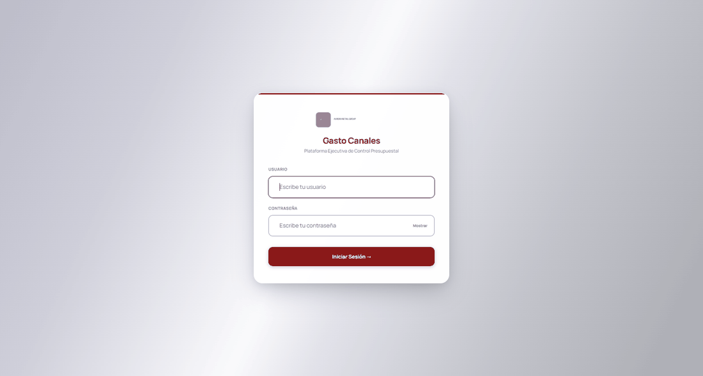

# Shareable demos

Ready-to-share animated GIFs of every project. Each is under 1 MB, 1100 px wide and loops forever, so they work in a README, a Slack message, an email, a LinkedIn post or a slide.

| File | What it shows |
|------|---------------|
| [`01-weekly-spend-dashboard.gif`](01-weekly-spend-dashboard.gif) | The original Dash + DuckDB spend dashboard running on synthetic data: sign-in, summary, account hierarchy, points of sale, cost centers, closings, time view, the Cashi assistant, alerts and dark theme |
| [`02-opex-control-dashboard.gif`](02-opex-control-dashboard.gif) | The rebuilt Opex Control dashboard: summary, hierarchy drill-down, overspend alerts, anomaly series, heat map, pivot and assistant |
| [`03-payly-support-agent.gif`](03-payly-support-agent.gif) | The LLM support agent answering with a real local model: order lookup, policy, escalation and cross-customer protection |
| [`04-paper-trading.gif`](04-paper-trading.gif) | The paper-trading simulation: capital vs SPY, open positions and the trade ledger |
| [`05-portfolio-site-tour.gif`](05-portfolio-site-tour.gif) | A pass over the published portfolio site |

Live site: https://yoyo1505.github.io/My_Portfolio/

## Embed

Markdown (works in GitHub READMEs):

```markdown

```

HTML:

```html

```

For chat and email, download the file from the repository (Raw > Save as) and attach it.

## Rebuild

`python share/make_share_gifs.py` rebuilds these files from the screenshots in `docs/`. The screenshots themselves come from `dash-app/synthetic/capture_dash.py`, `opex-control/scripts/capture.py` and `support-agent/scripts/capture_agent.py`.
