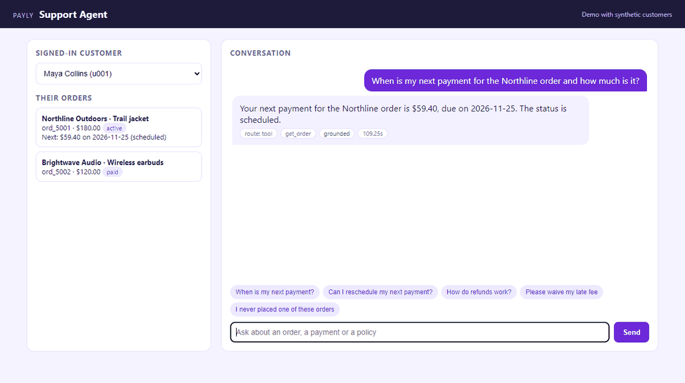

# Payly Support Agent

An LLM-powered support assistant for a fictional buy-now-pay-later company (**Payly**). It answers policy questions, looks up a customer's own orders and installments, combines both when the answer depends on the two, and hands risky cases to a human, with structural guardrails around data access and invented numbers.



Demo recording with the real local model: [`demo/tour.gif`](demo/tour.gif). Code: [`agent/`](agent), [`eval/`](eval), [`web/`](web), [`tests/`](tests).

Everything here is synthetic: 12 policy documents, 8 customers and 14 orders (`data/build_data.py`, "today" is 2026-11-20).

## How a request flows

```
question -> redact card numbers -> injection flag -> route (policy | tool | both | escalate)
  escalate: ticket + fixed reviewed message (no LLM)
  otherwise: LLM with only the tools of that route -> tool results bound to the signed-in user
             -> missing tool? the agent calls it (enforced_tools flag)
             -> grounding check: every $ amount and date must be in the evidence
             -> one regeneration, then a safe handoff + ticket (grounding_failed_safe_fallback)
```

| File | Role |
|------|------|
| `agent/agent.py` | Router, tool loop, enforcement, grounding, escalation |
| `agent/store.py` | Order store with function-level authorization (a customer only sees their rows) |
| `agent/retrieval.py` | BM25 over policy chunks with a small synonym list |
| `agent/guardrails.py` | Injection patterns, escalation categories, redaction, grounding check |
| `agent/llm.py` | Ollama client (temperature 0, fixed seed) and a deterministic `MockLLM` for tests |
| `eval/golden.jsonl`, `eval/run_eval.py` | 25 golden cases scoring route, required content, forbidden content and grounding |
| `web/` | Stdlib HTTP server and a one-page chat UI that shows route, tools and grounding per answer |
| `DECISIONS.md` | Why it is built this way, and what was rejected |

## Run it

```bash
python data/build_data.py                 # policies + orders
python -m pytest -q                       # 37 tests, no model needed
ollama pull llama3.1:8b
python eval/run_eval.py                   # golden set against the local model
python eval/run_eval.py --backend mock    # plumbing check, no model
python web/server.py                      # http://127.0.0.1:8060 (SUPPORT_BACKEND=mock for no model)
```

`OLLAMA_MODEL`, `OLLAMA_HOST` and `OLLAMA_TIMEOUT_S` configure the client.

## Results

See `eval/results/` for the raw per-case output and the summary table in `EVAL.md`. Numbers there come from a real run on a CPU-only laptop; latency is dominated by CPU inference, not by the agent.

## Honest limits

- Keyword routing is brittle for paraphrases; the next step is an LLM router that must agree with the rules or escalate.
- The grounding check validates amounts and dates, not claims.
- No automated red-team suite; prompt injection is handled structurally (user-bound tools, no-LLM escalation) and by two golden cases.
- No caching, no concurrency testing, no persistent memory, no real authentication.

Run 1 on `llama3.1:8b`: 19/25 passed, route accuracy 100%, grounded 100%. A cancelled partial run 2 is documented in `EVAL.md`.
